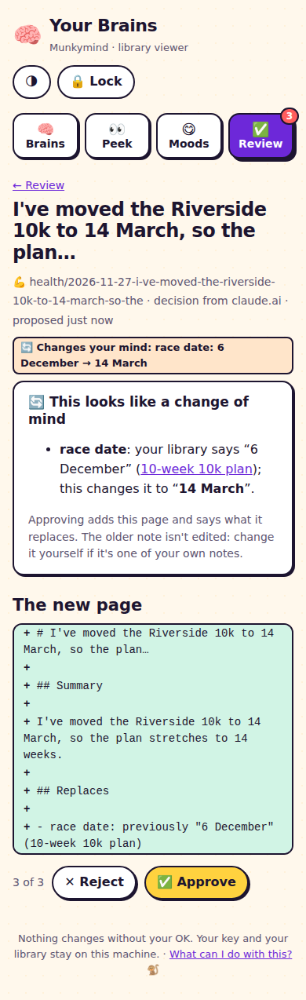
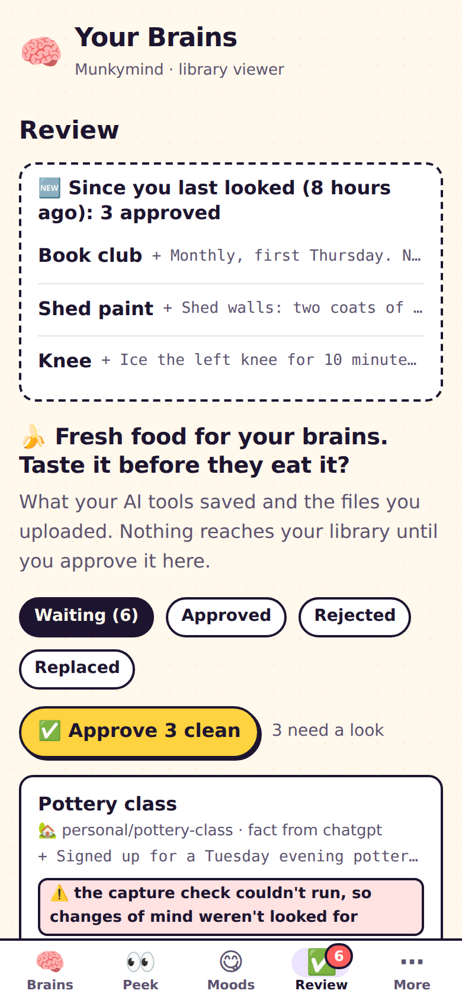
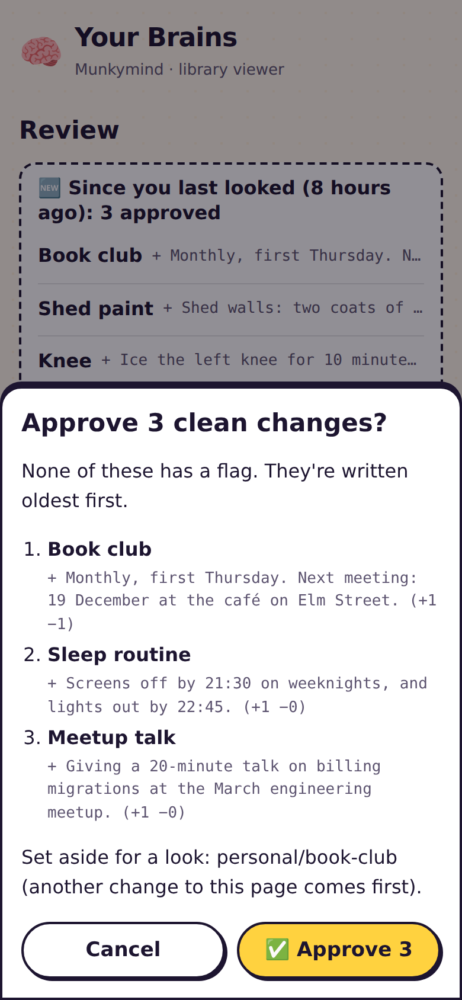
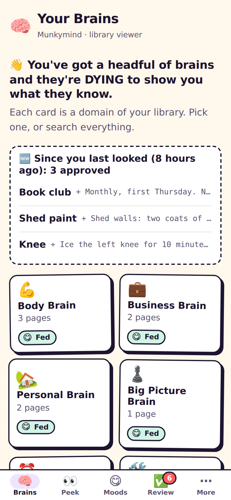
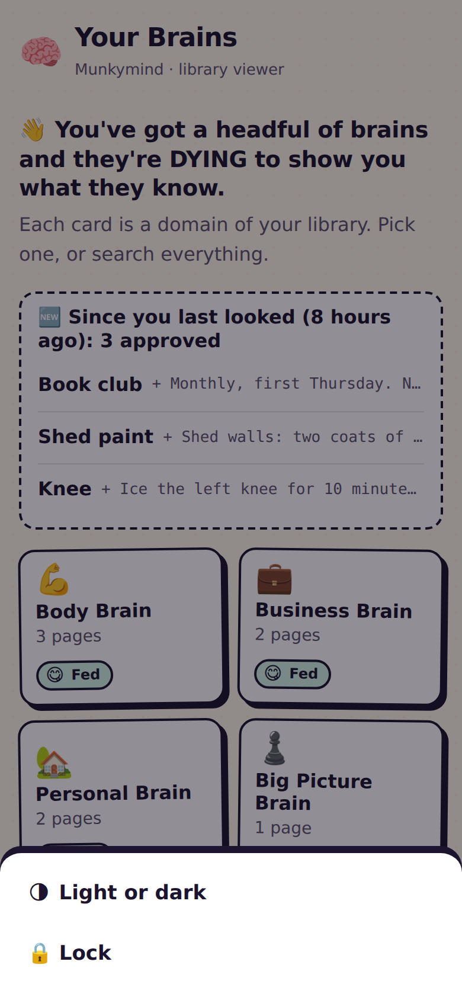

# What can I do with Munkymind?

You've installed it. Now what?

Munkymind sits between your notes and your AI tools. You feed it notes once; after that, Claude, ChatGPT or Cursor can answer from them, with sources, in any conversation. You'll use it in three places:

| Where | What it's for |
|---|---|
| **Your AI tools** (Claude Desktop, claude.ai, ChatGPT, Cursor) | The main event: ask questions that need your context |
| **The viewer** at `http://localhost:8000/ui` | See what Munkymind knows, check freshness, peek at what your AI gets sent, approve what your AI saved |
| **The terminal** (`munkymind …`) | Feed it, check on it, script it |

**The language you'll see:** each topic is a **brain** (Body Brain, Business Brain…), your notes are **brain food**, and your AI tools are the brains' **senses**: they take in what you tell them and use what the brains know. Freshness shows as each brain's **mood**.

No notes handy? Use the made-up library in [`examples/sample-notes`](../examples/sample-notes): set `MM_NOTES_DIR=./examples/sample-notes` in `.env` and every example below works as written.

---

## Your first 15 minutes

### 1. See your brains (2 min)
Open **http://localhost:8000/ui** and paste your API key (the `mm_sk_…` key from setup). Or skip the pasting: `docker compose exec api munkymind login-link --user <you>` prints a one-time link that signs this browser in.

- **🧠 Brains** shows one card per domain: Body Brain (health), Business Brain (work), Big Picture Brain (strategy) and so on. Click one to see its pages, then open a page to read it, with where it came from and how fresh it is.
- Search finds titles and tags. Press `/` to jump to the search box.

**Check:** did it put things in the brain you expected? If not, folder and file names decide the domain (`notes/health/sleep.md` → health). Rename and re-ingest.

### 2. Peek at what your AI would see (3 min)
Open **👀 Peek** and type a real question, e.g. *"What's my training plan this week?"*

You'll see the exact snippets your AI would be sent, in order, and what share of your library that is. This is the point of Munkymind: your AI gets a few relevant paragraphs, not your whole life, so answers are grounded and cheap. No AI is called for a Peek.

### 3. Ask from your AI tool (5 min)
Munkymind plugs into your AI tools through **MCP**, the standard way Claude, ChatGPT and Cursor call outside tools. Connect one tool (setup steps are in the [quickstart](quickstart.md)):
- **Claude Desktop / Cursor:** run `bash setup-mcp.sh`, or use the manual config in the README
- **claude.ai or ChatGPT:** add Munkymind as a custom connector (quickstart step 4)

Then ask something that needs your context:
> *"Using Munkymind, what should I focus on this week?"*

Your AI calls Munkymind's tools by itself:

| Tool | What it does |
|---|---|
| `query_context` | Finds the most relevant notes for a question (the one you'll see most) |
| `search_pages` | Looks up pages by keyword |
| `get_page` | Reads one page in full |
| `list_domains` | Lists your brains and how many pages each has |
| `get_staleness_report` | Lists notes that are out of date |
| `capture` | Saves something you said to your Review queue (see [Review queue](#review-queue)) |

Answers cite the pages they used. If a note is stale, the answer says so.

### 4. Keep it fresh with 😋 Moods (2 min)
Open **😋 Moods**. Each brain has a mood: 😋 Fed, 😐 Peckish, 😴 Starving. Every domain has a freshness window (temporal notes go stale in 3 days, personal ones in 60).

Brains feed themselves: every 5 minutes Munkymind checks your notes folder and re-indexes whatever you added, edited or deleted. Can't wait? Feed them now:
```bash
docker compose exec api munkymind ingest --connector files --user <you>
```
Existing pages are updated, not duplicated.

### 5. Make it yours (3 min)
```bash
munkymind domain add garden "Garden" --user <you> --icon 🌱 --brain-name "Garden Brain"
munkymind status --user <you>            # how your brains are doing
```
Prefer it without the jokes? Set `MM_VOICE=plain` in `.env` and restart.

---

## Review queue

Your AI tools can save things to Munkymind, not only read from it. Nothing they save reaches your library until you approve it.

### How it works
1. **You say something worth keeping.** *"I've moved the Riverside 10k to 14 March."* Your AI tool calls `capture` (or ask it: *"save that to Munkymind"*).
2. **Munkymind checks it.** For a decision, preference or fact, it looks at the most relevant pages in your library and asks your answer model whether this changes something they say. If it does, the AI tool hears it straight away: *"Heads up, this looks like a change of mind: your library says "6 December" (10k plan); this changes it to "14 March"."* It can ask you while you're still talking.
3. **It waits in ✅ Review.** Open the viewer's Review tab (the number on it is how many are waiting). Each row shows the page, where it came from, a one-line peek at the change (the first new line, and how many lines are added and removed), and a 🔄 flag for a change of mind.
4. **You decide.** ✅ **Approve** writes the page and indexes it, so the next question finds it. ✕ **Reject** changes nothing.

Approved pages are kept in Munkymind's own folder (`users/<you>/context-repo/<brain>/`), never in your notes folder. Approving a change of mind adds a page that says what it replaces; it doesn't edit your older note, so update that note yourself if it's one of yours.



### Approve the clean ones in one go
A proposal is **clean** when it has no flag: no change of mind, no warning. When some are waiting, Review shows **✅ Approve N clean**. It opens a confirm sheet that lists each page and its peek; confirm, and they're written oldest first. Flagged proposals are never part of it: open each one and decide.

Two cases are set aside as **👀 Needs a look** instead of being forced through, and the row says why:
- **A second change to the same page.** Approving the first changes the page under the second, so the second gets a proper look afterwards.
- **The page changed after the proposal was made** (the conflict below).

After the batch, the viewer opens the oldest proposal still waiting.




### Since you last looked
Review, and the Brains home, show what was approved since you last opened the viewer in this browser, one line each; tap a line for the change. The time is kept in this browser only (nothing on the server), so another device has its own. If the browser blocks storage, the strip just doesn't show.



### On a phone
At phone width (640px and under) the tabs move to a bar at the bottom of the screen, with the Review count on it. **⋯ More** holds the theme switch, 🔒 Lock and any links the server adds. On a wider screen the tabs stay at the top.



### Open on Review when something is waiting
By default the viewer opens on 🧠 Brains. A server owner can set `MM_UI_HOME=review-if-pending` (in `.env`, then `docker compose up -d`): opening the viewer, or coming back to it after 10 minutes or more, goes straight to Review when anything is waiting, and to Brains when nothing is. A link to a particular page still opens that page. It's off by default because Review is only useful to someone who can decide: a login-link sign-in can't, and the Review count already shows on the tab. `munkymind doctor` reports the setting.

**From the terminal:**
```bash
munkymind review list -u <you>                  # what's waiting
munkymind review show <id> -u <you>             # the change, and any change of mind
munkymind review approve <id> -u <you>          # or: reject
munkymind review approve --clean -u <you>       # every clean one, oldest first, after a confirm (--yes skips it)
```
In Docker, put `docker compose exec api` in front.

**"This page changed after the proposal was made."** Two proposals for the same page, or an edit in between: the second one was written against an older version. Approve anyway to replace the page with it, or reject it.

**Who can decide.** Approving and rejecting, one at a time or the clean ones in one go, need your read-write API key. A read-only key or a login-link sign-in shows the queue (and which ones are clean) but has no approve buttons; the page tells you how to decide (sign in with your key, or use the terminal).

**Over the API:** `GET /review` lists what's waiting; its `batch` field says which ids approving the clean ones would write (`approve`) and which it sets aside (`needs_look`, with a reason). `POST /review/batch` with `{"ids": [...]}` approves those that are still clean, oldest first, and returns `approved`, `needs_look` and `skipped` (flagged, already decided or unknown). `GET /review?status=approved&since=<ISO time>` lists what was approved after that time.

### What goes through Review

| Source | Through Review? |
|---|---|
| `capture` from an AI tool, `POST /capture` | Always |
| Uploads (`POST /ingest/files`) | Yes by default; `MM_REVIEW_UPLOADS=off` indexes them at once |
| Your notes folder (automatic sync, `munkymind ingest`) | No: they're your own files |

### Guardrails and switches
- Text that looks like a password, key or token, or like instructions to an AI, is held back and never queued. `munkymind doctor` tells you when something was held back.
- 10 captures a minute and 200 a day, per AI tool.
- Capturing needs a read-write key. A read-only key can still ask questions.
- `MM_CAPTURE=off` refuses captures. `MM_CAPTURE_CHECK=off` skips the change-of-mind check (then nothing from your library is sent to your answer model when capturing).

---

## Use cases

Each one says what to feed it and what to ask. The prompts work as written with the sample notes.

### 🧭 Cross-domain planning (where Munkymind shines, so start here)
**Feed:** a bit of everything.
**Ask:**
- *"Given my goals and this week's calendar, what are my top three priorities?"*
- *"Does taking on the billing migration fit my five-year plan?"*

One question draws on several brains at once (work, strategy, calendar) and the answer cites each source.

### 🏃 Personal coach
**Feed:** training plans, sleep or health notes, your calendar for the week.
**Ask:**
- *"Plan my runs this week around my calendar."* It should spot that Wednesday's late call means no run that day.
- *"My knee aches today. What did I decide to do about that?"*

**Why it's better than pasting:** your plan, your rules and your week come together without you re-explaining them every time.

### 💼 Work brain (managers, leads)
**Feed:** OKRs, 1:1 notes, project briefs, decisions.
**Ask:**
- *"Prep me for my 1:1 with Priya: open actions and anything she raised last time."*
- *"Which of my Q4 key results are at risk, and why?"*

### 👩‍💻 Developer context
**Feed:** the GitHub connector (`munkymind ingest --connector github --user <you>`): your profile, repos and READMEs.
**Ask (in Cursor or Claude Code):**
- *"Which of my repos already solve auth? Point me at the README."*
- *"Summarise what I've been building this year."*

### 📚 Learning and reading
**Feed:** reading lists, highlights, course notes.
**Ask:** *"Which book did Priya recommend, and where is it on my list?"* or *"What should I read next, given what I liked this year?"*

### 🔨 Projects and DIY
**Feed:** project notes, shopping lists, decisions.
**Ask:** *"What do I still need to buy for the shed?"*

---

## Tester missions

Testing an early release? Try these, then [file a tester report](https://github.com/munkymind/munkymind/issues/new?labels=tester-report&title=Tester%20report%3A%20). Even "gave up at step X" helps.

1. ⏱️ **Install:** time from `git clone` to your first answer. Note where you got stuck.
2. 🧠 **Brains:** open `/ui`. Did your notes land in the right brains?
3. 👀 **Peek:** ask three real questions. Were the snippets the right ones?
4. 💬 **Ask:** connect one AI tool and ask a cross-domain question. Was the answer right, and did it cite sources?
5. 🔁 **Re-feed:** edit a note, re-ingest, and ask again. Did the answer change?
6. 😂 **Voice:** did any message make you smile, or wince? Quote it.
7. ✅ **Review:** tell your AI tool something that contradicts a note (*"I've moved the 10k to March"*). Did it warn you about the change of mind? Approve it in Review, then ask again: does the answer use the new value?

---

## When something's off

| You see | Try |
|---|---|
| "This information is not in your context library." | Peek the same question. If no snippets show, the note isn't ingested or uses different words; re-ingest or rephrase |
| A brain is 😴 Starving | Its notes are past their freshness window: re-ingest the source, or raise that domain's `staleness_threshold_days` in your `config.yaml` |
| The viewer says the brains don't recognise you | Paste the full `mm_sk_…` key. Lost it? `munkymind user rotate-key <you>` |
| "All brains are on a smoke break" | The API isn't running: `docker compose up -d` |
| Your AI tool says it saved something, but the answer hasn't changed | It's waiting in ✅ Review: approve it there, or `munkymind review list -u <you>` |
| Review says the sign-in "can look but not decide" | You signed in with a login link (read-only). Lock, then sign in with your `mm_sk_…` key, or use `munkymind review approve` |

More fixes are in the [quickstart's troubleshooting section](quickstart.md#troubleshooting).
